# WEDE5020-POE
A repository for my web development assignment in wede5020

# Chubby Chums

## Student Information
- **Name:** Olothando Mabuto
- **Student Number:** ST1052487
- **Module:** WEDE5020

## Project Overview
Chubby Chums is a non-profit child protection organization founded in 1999 by Tony Barnard and Martin Graham to help impoverished, diseased, and abused children. Starting from a single enclosed veranda, the organization has grown to incorporate 36 children's homes. It was officially registered as a Section 21 corporation in 2000, and is recognized as a Non-Profit Organization (NPO), Non-Government Organization (NGO), and Public Benefit Organization (PBO) (Chubby Chums, 2026).

Chubby Chums works in partnership with Child Protection Units and Child Treatment Services to stop child abuse, child neglect, and child exploitation, and to promote the importance of Early Childhood Development (ECD). The organization primarily operates in Johannesburg and the Far East Rand Regions (Chubby Chums, 2026).

This website redesign project aims to modernize the organization's online presence, making it more informative, accessible, and functional for visitors, donors, and people needing to report concerns about a child's welfare.

**Target Audience:** Children in need — including those in abusive households, those living in poverty, and those struggling with illnesses and diseases — along with the general public, donors, and potential volunteers (Chubby Chums, 2026).

## Website Goals and Objectives
The goal of the website is to provide key insights into the Chubby Chums organization and its operations — detailing where, why, and how it operates — while also providing clear information on contacting Chubby Chums and reporting child neglect or abuse to child protection services. The website also gives visitors a direct way to donate.

**Key Performance Indicators (KPIs):**
- **Website Traffic** — how many people are visiting the site and learning about Chubby Chums
- **Monthly Donations** — number of donations made via the website each month
- **Recurring Donors** — number of donors who continue to donate over time
- **Average Donation Amount** — average amount donated per donor
- **Conversion Rate** — percentage of visitors who go on to donate

## Key Features and Functionality
- Consistent navigation across all pages: Home, About, Donate, Enquiry, Contact, styled as colour-coded pill buttons using Flexbox
- **Home page** introducing the organization and its mission, with a hero section, mission statement, and a card-based row linking to About, Donate, Enquiry, and Contact
- **About page** with detailed history, registration status, and partnerships, using alternating text/image layouts
- **Enquiry page** allowing visitors to report suspected child abuse or neglect, with emergency contact numbers (SAPS and Childline) and a styled report form alongside a supporting image
- **Contact page** with phone, email, physical address, and a styled general contact form
- **Donate page** with full banking details and official registration/compliance information, presented in bordered information panels
- Fully responsive layout using CSS Flexbox, tested and adjusted at desktop, tablet (≤768px), and mobile (≤480px) breakpoints
- Custom-styled form elements (inputs, select, textarea) with consistent focus/hover/active states across the site
- **Interactive elements (Part 3):** an animated accordion and an image gallery with a lightbox on the About page, an interactive map on the Contact page, and a statistics section called "Our Impact" on the Home page that is built with JavaScript
- **Dynamic content (Part 3):** a FAQ on the Enquiry page that can be searched, filtered by category and sorted
- **Working forms (Part 3):** contact and enquiry forms with JavaScript validation that send their submissions through Netlify Forms

## Design Direction
The original proposal specified a colour scheme of white, black, yellow, blue, and green on a light background, using Arial. During the CSS phase, this was revised:

- **Colour palette expanded** to red (`#FF0000`), green (`#1AFF00`), yellow (`#FFF200`), blue (`#00A2FF`), orange (`#FF9900`), and purple (`#BF00FF`), with black (`#000000`) and white (`#FFFFFF`) used for text and background, to increase the colourful, child-friendly feel while keeping content readable.
- **Background inverted from light to dark** (black background, white text) after prototyping both options. This was chosen because the brighter accent colours read more vividly against black, photographs of children/donations sit well against a dark background, and white nav-link text improved readability against the blue and purple accent buttons specifically.
- Arial (with Helvetica/sans-serif fallbacks) was retained as originally proposed.

## Timeline and Milestones
- **14 August 2026** — Proposal and HTML framework
- **18 September 2026** — Applying CSS, responsive design, and improving UI/UX

## Part 1 Details
Part 1 covers the initial proposal and static HTML framework: page structure, navigation, and core content for the Home, About, Enquiry, Contact, and Donate pages, built without CSS or JavaScript.

## Part 2 Details
Part 2 covers visual design and responsiveness across all five pages:
- An external stylesheet (`CSS/chubbychums.css`) linked to every page
- A base style and CSS reset (`* { margin: 0; padding: 0; box-sizing: border-box; }`) to normalise browser defaults
- A typographic scale (h1 2.5rem, h2 2rem, body text 1rem, `line-height: 1.5` for readability) using `rem` units for accessibility
- Flexbox-based layouts for the navigation bar, hero sections, the home page's card row, and the enquiry page's form/image section, including nested flex containers for the card components
- Visual styling using `color`, `background-color`, `border`, and rounded corners (`border-radius`) throughout, plus `:hover`, `:focus`, and `:active` pseudo-classes for interactive feedback on links and form fields
- Responsive design implemented with media queries at 768px (tablet) and 480px (mobile), switching Flexbox rows to a stacked column layout on smaller screens and scaling down heading font sizes on mobile
- Screenshot evidence of the site at desktop, tablet, and mobile widths (see `/screenshots` — 15 screenshots covering all five pages at three breakpoints)

## Responsive Design Evidence

The site was tested and verified at three breakpoints — desktop, tablet (≤768px), and mobile (≤480px) — using browser developer tools' device toolbar. Screenshots for all five pages at each breakpoint are below.

### Desktop
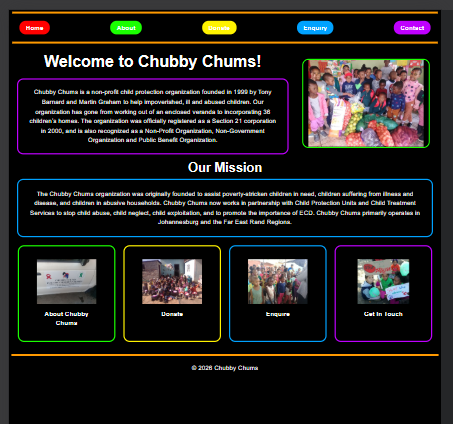
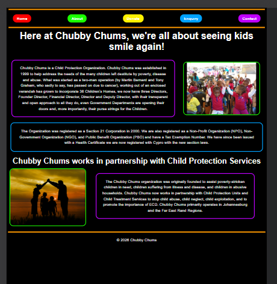
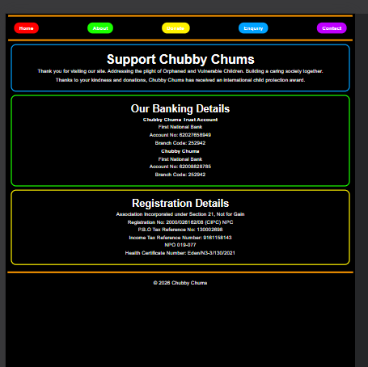
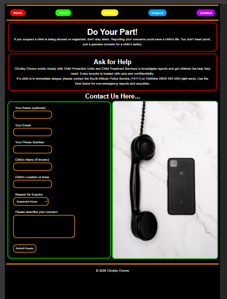
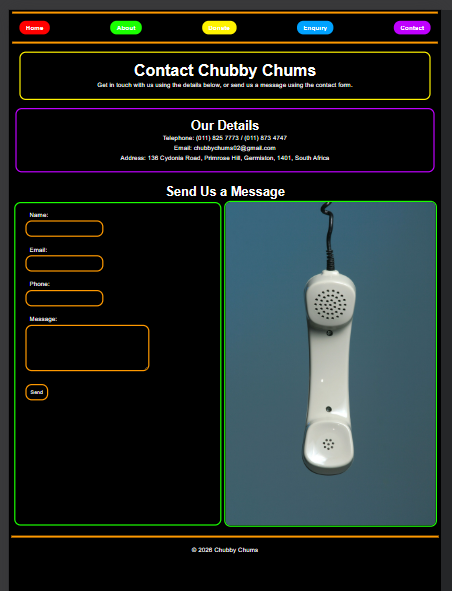

### Tablet (768px)
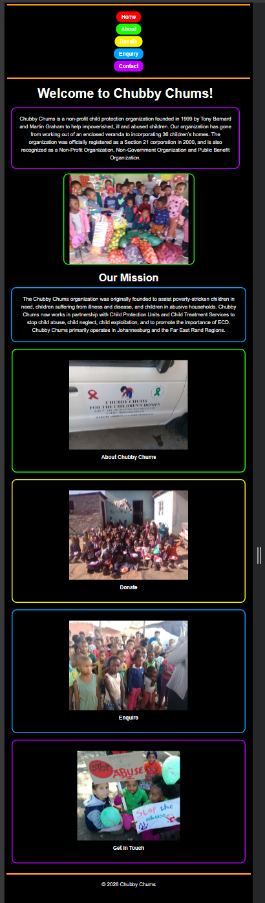
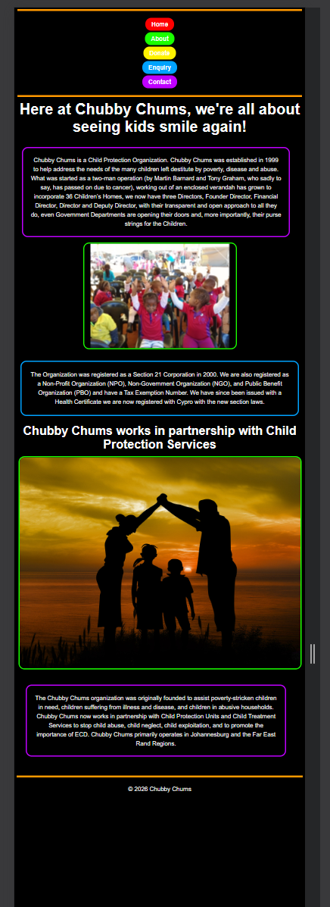
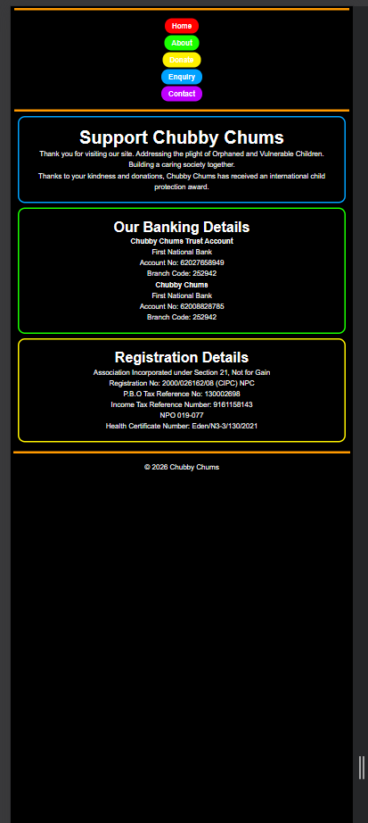
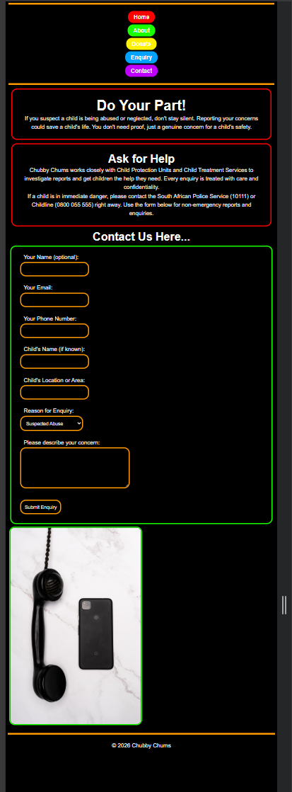
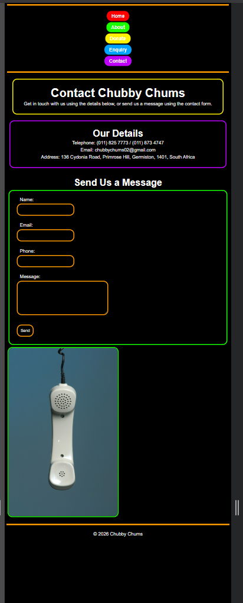

### Mobile (480px)
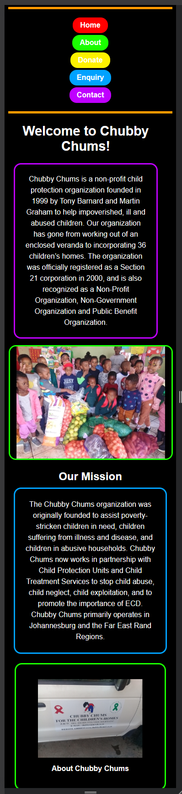
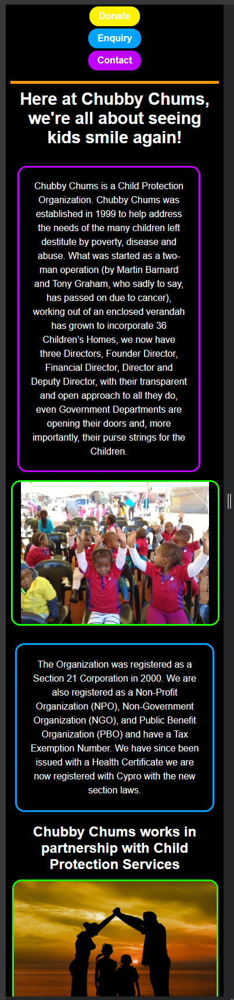
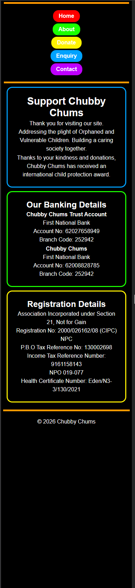
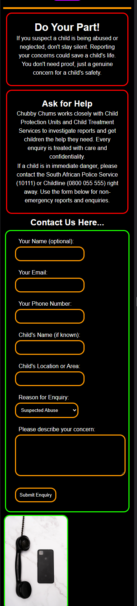
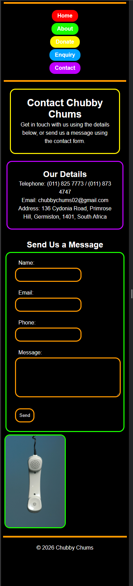

Part 3 (further interactivity and refinement) is described in the Part 3 Details section below.

## Sitemap
Home (index.html)
|-- About (about.html)
|-- Donate (donate.html)
|-- Enquiry (enquiry.html)
|-- Contact (contact.html)

## Changelog
- Created `index.html` — homepage with mission and services overview
- Created `about.html` — organizational history and partnerships
- Added `contact.html` — contact details and general contact form
- Added `enquiry.html` — child abuse/neglect reporting form with emergency contacts
- Added `donate.html` — banking details and registration information
- Added HTML comments across all pages for clarity and maintainability
- Linked external stylesheet (`CSS/chubbychums.css`) to all pages
- Established base styles, CSS reset, and typographic scale
- Expanded colour palette (added red, purple, additional accents beyond original proposal) and inverted site theme from light to dark background
- Built Flexbox navigation bar with colour-coded, rounded pill-style links and hover/focus/active states
- Built Flexbox hero sections (text + image) on the home and about pages
- Built nested Flexbox card row on the home page linking to About, Donate, Enquiry, and Contact
- Styled and structured the enquiry form (labels, inputs, select, textarea) with a supporting image in a Flexbox layout
- Styled the contact form to match the site-wide input/select/textarea design
- Added responsive media queries (768px and 480px breakpoints) across all pages, converting Flexbox rows to stacked columns and scaling typography on smaller screens
- Captured screenshot evidence of all five pages at desktop, tablet, and mobile widths
- Added an animated accordion with keyboard and screen reader support (`aria-expanded`) to the About page, and replaced the repeated click listeners with one loop
- Added a gallery with a lightbox (previous/next buttons, keyboard arrows, Escape to close) to the About page
- Added an interactive Leaflet map with a marker, popup and "Recentre map" button to the Contact page
- Added a JavaScript-built "Our Impact" statistics section with a count-up animation to the Home page
- Added an emergency notice and a live character counter to the Enquiry form
- Added a FAQ with search, category filter, sorting and highlighted matches to the Enquiry page
- Added JavaScript validation to the contact and enquiry forms
- Added SEO improvements: titles, meta descriptions, share tags, favicon, structured data, renamed and resized images, internal links, `robots.txt`
- Fixed the sideways scrolling on small screens (accordion buttons and message boxes were too wide)
- Deployed the site to Netlify, connected both forms to Netlify Forms, and added `sitemap.xml`, canonical links and security headers

## Part 3 Details
Part 3 adds interactivity, dynamic content, SEO, form handling and deployment. All JavaScript is in `JavaScript/chubbychums.js`, split into labelled sections, and runs only on the pages that need it.

### Interactive elements
- **Accordion (About):** the Registration and Partnerships buttons show and hide their panels. Panels fade and slide in, and the animation is switched off for visitors who ask their device for reduced motion.
- **Gallery with lightbox (About):** six photos open in a larger view with a caption and counter. The lightbox has previous/next buttons, left/right arrow keys, closes with the button, Escape or a click outside the photo, keeps keyboard focus inside while open, and returns focus to the photo that was clicked.
- **Interactive map (Contact):** Leaflet shows the office location with a marker and popup. The map tiles come from CARTO (dark style) using a free API key, and fall back to OpenStreetMap if no key is set. If the map library cannot load, a message and a Google Maps directions link are shown instead.
- **Animations and transitions:** CSS animation for the accordion panels and the button hover transitions, plus a JavaScript count-up animation for the statistics.
- **Advanced DOM manipulation:** the "Our Impact" section is created entirely with `createElement` and `appendChild` from a list of facts, with a count-up triggered by an `IntersectionObserver`. The Enquiry page inserts and removes an emergency notice depending on the chosen reason, and adds a live character counter. The FAQ rebuilds its list every time the visitor searches, filters or sorts.

### Dynamic content
- **FAQ (Enquiry):** 15 questions in four categories are loaded from a JavaScript list. The visitor can search (every typed word must match), filter by category and sort A-Z or Z-A. Matching words are highlighted, and a "Showing x of y questions" message and a no-results message keep the visitor informed. Some answers link to the page with more information.

### Coding rules followed
- Variables are declared with `let`; `const` is not used.
- `console.log` is not used.
- Text added to the page by JavaScript is inserted as plain text, not as HTML.

## Form Validation

JavaScript validation was added to the contact form and the enquiry form (`chubbychums.js`). Both forms use the `novalidate` attribute so the JavaScript messages are shown instead of the browser's default pop-ups.

| Field | Rules |
|-------|-------|
| Name (contact: required, enquiry: optional) | 2-60 characters; letters (including accented), spaces, apostrophes, full stops and hyphens only |
| Email (contact: required, enquiry: optional) | Must look like `name@example.com` |
| Phone (optional on both forms) | South African number: 10 digits starting with 0, or +27 followed by 9 digits; spaces, hyphens and brackets allowed |
| Child's name (enquiry, optional) | Same rules as a name |
| Child's location (enquiry, required) | 3-100 characters |
| Reason for enquiry (enquiry, required) | A reason must be chosen from the drop-down |
| Message / description (both, required) | 10-2000 characters |

- **Feedback:** each problem is shown under its field in red, with a summary at the top of the form after a failed submit. The first problem field is focused automatically.
- **Timing:** a field is checked when the visitor leaves it (after they have typed in it), and the message clears as soon as the value is fixed. Empty required fields are only reported on submit.
- **Accessibility:** fields use `required`, `aria-invalid` and `aria-describedby`, errors are announced to screen readers, and the checks work with the keyboard alone.
- **Anonymous reports:** the enquiry form accepts a report with no name, email or phone number, because reporters may wish to stay anonymous.
- **Sending:** once every field is valid, the form is sent with `fetch` to Netlify Forms. Both forms carry `data-netlify="true"`, a form name (`contact` or `enquiry`) and a hidden spam-trap field. The visitor sees a thank-you box when Netlify accepts the message, or an error box with the phone numbers (and the SAPS and Childline numbers on the enquiry form) if sending fails. A second click while a message is being sent is ignored.

## Search Engine Optimization (SEO)

### On-page SEO
- **Keyword research:** keywords were chosen from the wording used on the site and the questions visitors are likely to ask. Search volumes can be confirmed with Google Keyword Planner or Google Trends. The keywords were worked into page titles, meta descriptions, image alt text, the FAQ and link text, without rewriting the original page content.

| Page | Main keyword | Supporting keywords |
|------|--------------|---------------------|
| Home | child protection organization South Africa | non-profit, children's homes Johannesburg, Chubby Chums |
| About | Chubby Chums | child protection NPO, Section 21, PBO, Child Protection Units |
| Donate | donate to children's charity | support vulnerable children, orphaned children South Africa |
| Enquiry | report child abuse South Africa | suspected child neglect, Childline, SAPS 10111 |
| Contact | Chubby Chums Germiston | 136 Cydonia Road, Primrose Hill, contact |

- **Title tags and meta descriptions:** every page has a unique title (52-57 characters) and a unique meta description (143-155 characters) that describe the page and include its main keyword.
- **Header tags:** each page has exactly one `<h1>`, followed by `<h2>` headings for its sections.
- **Image optimisation:** images were renamed with descriptive file names (for example `children-eating-outdoors.jpg` instead of `kids2.jpg`), given accurate alt text, and given width and height attributes. The three oversized images were resized (832 KB reduced to 157 KB), and images below the first screen use lazy loading.
- **URL structure:** pages use short, descriptive, lowercase names (`about.html`, `donate.html`, `enquiry.html`, `contact.html`). On Netlify they are served as `/about`, `/donate`, `/enquiry` and `/contact`.
- **Internal linking:** a "Get Involved" section on the About page, a related-links section on the Donate page, and "read more" links in the FAQ answers connect the pages using descriptive link text.
- **Mobile-friendliness:** responsive layouts were checked at 320, 360, 390, 414 and 768 pixels wide, and the sideways scrolling that appeared on small screens was fixed.

### Off-page SEO (plan)
- **Backlinks:** ask partner organisations, Child Protection Units, local community groups and non-profit directories to link to the website, and ask local news outlets to link to it when they feature Chubby Chums.
- **Social media:** share the website on the organisation's social media pages. The Open Graph tags on each page control the title and description shown when a link is shared.
- **Local SEO:** the organisation's name, address and phone number are the same on the contact page, the map popup and the structured data (JSON-LD) on the home page, which also lists the areas the organisation serves. Creating a Google Business Profile for 136 Cydonia Road, Germiston would strengthen local search results.

### Additional requests
- **robots.txt:** tells search engines to crawl the site but skip the `screenshots` folder, and gives the address of the sitemap.
- **sitemap.xml:** lists the five pages, using the same addresses as the canonical links.
- **Page speed:** smaller images, lazy loading, image dimensions set to avoid layout shift, and early connection to the map servers on the contact page.
- **Security:** the Leaflet library is loaded with a subresource integrity check, external links use `rel="noopener noreferrer"`, and content added by JavaScript is inserted as plain text so it cannot run as code.

### Added after deployment
- **Canonical links:** every page names its own main web address, so search engines do not treat variations of the address as separate pages.
- **Share tags:** each page's Open Graph tags include the page address and a preview image, and a Twitter card tag, so shared links show a title, description and picture.
- **Structured data:** the home page's JSON-LD includes the website address.
- **Security headers:** see the Deployment section.

## Deployment

- **Platform:** Netlify (free plan). It was chosen over GitHub Pages because Netlify can also receive form submissions, which GitHub Pages cannot.
- **Live site:** https://sage-narwhal-2e7353.netlify.app
- **How it was deployed:** the `WEDE5020POE` folder (the folder that contains `index.html`) was uploaded with Netlify's drag-and-drop deploy. To update the site, drag the updated folder onto the site's Deploys page in Netlify. The project is also stored in a GitHub repository.
- **Forms:** form detection is switched on in Netlify, so submissions from the contact and enquiry forms appear under *Forms*, and an email notification is set up under *Forms > Submission notifications*. Netlify reads the forms in the HTML when the site is deployed, so the site must be redeployed after any change to a form.
- **Security headers (`_headers`):** every page is served with `X-Content-Type-Options: nosniff` (browsers must respect the file type), `X-Frame-Options: DENY` and `frame-ancestors 'none'` (other sites cannot show the pages inside a frame), a `Referrer-Policy`, a `Permissions-Policy` that switches off the camera, microphone, location and payment features, and a Content-Security-Policy that only allows scripts from the site itself and the Leaflet library, and map images from the Leaflet and CARTO servers. Inline styles are still allowed because the map library needs them.
- **Testing:** the headers, the forms (successful and failed submissions, and double clicks), every page feature and the mobile layouts were tested on a local server that imitates Netlify.

## References
Chubby Chums. (2026). *Chubby Chums.* Available at: https://www.chubbychums1.co.za [Accessed 2026].

Lamaj, D. (2026). *Low fidelity wireframe.* Available at: https://uxpilot.ai/blogs/low-fidelity-wireframe [Accessed 2026].

Lucidity. (2026). *The complete list of charity KPIs.* Available at: https://getlucidity.com/strategy-resources/the-complete-list-of-charity-kpis/#Awareness_KPIs [Accessed 2026].

Mason, L. (2026). *Website hosting cost.* Forbes Advisor. Available at: https://www.forbes.com/advisor/business/website-hosting-cost/ [Accessed 2026].

CARTO. (2026). *CARTO basemaps.* Available at: https://docs.carto.com/faqs/carto-basemaps [Accessed 2026].

Leaflet. (2026). *Leaflet: an open-source JavaScript library for interactive maps.* Available at: https://leafletjs.com [Accessed 2026].

Netlify. (2026). *Custom headers.* Available at: https://docs.netlify.com/manage/routing/headers/ [Accessed 2026].

Netlify. (2026). *Forms setup.* Available at: https://docs.netlify.com/manage/forms/setup/ [Accessed 2026].

OpenStreetMap contributors. (2026). *OpenStreetMap copyright and license.* Available at: https://www.openstreetmap.org/copyright [Accessed 2026].

Schema.org. (2026). *NGO.* Available at: https://schema.org/NGO [Accessed 2026].